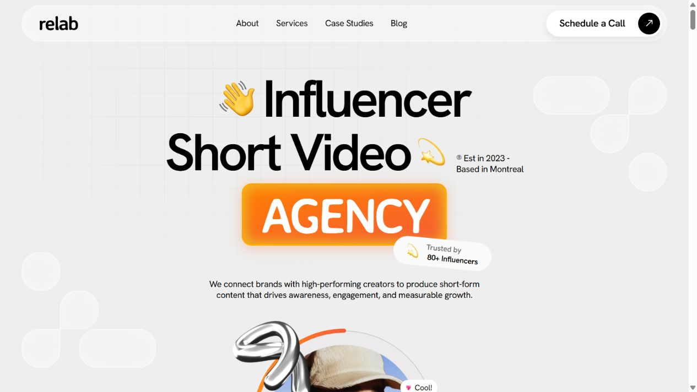
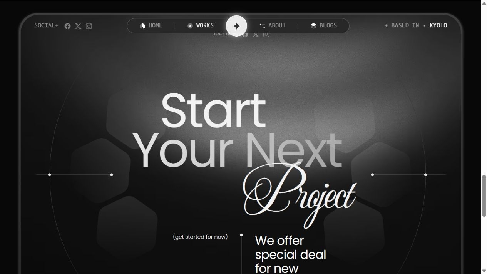
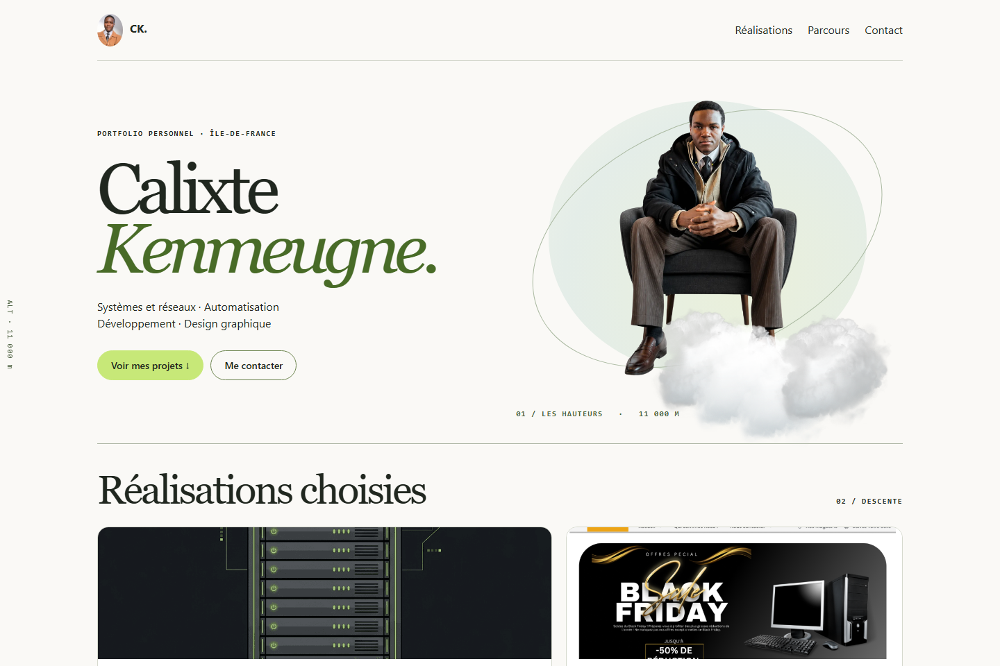
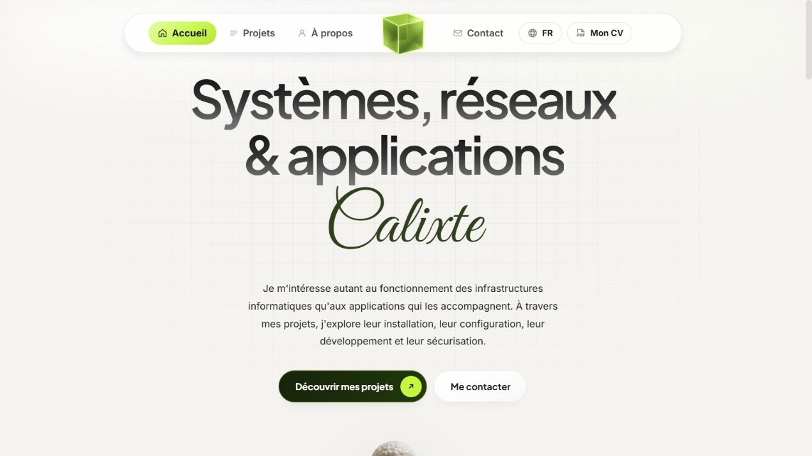
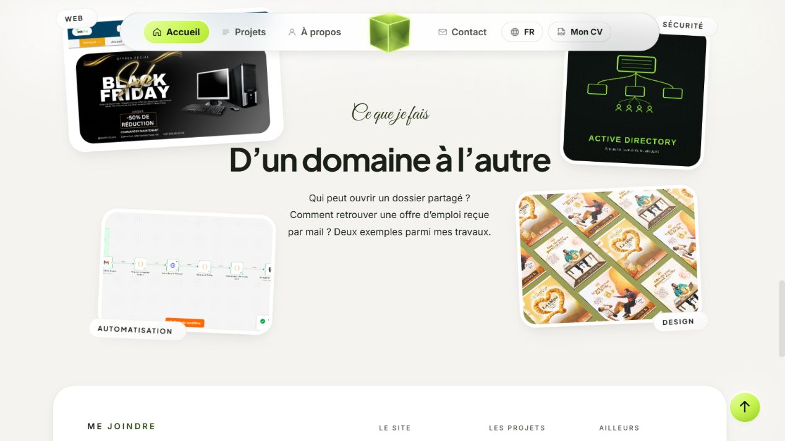
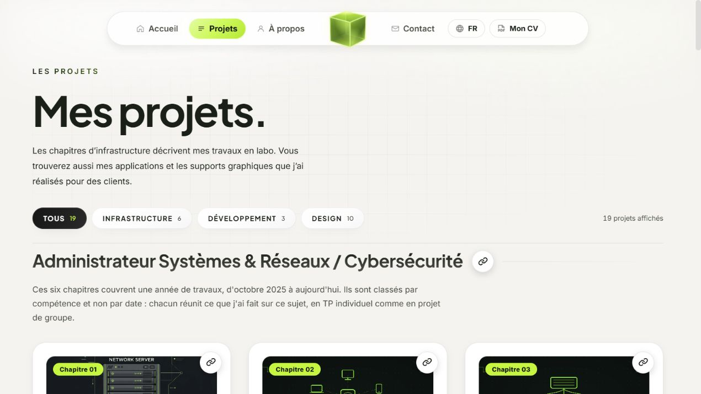
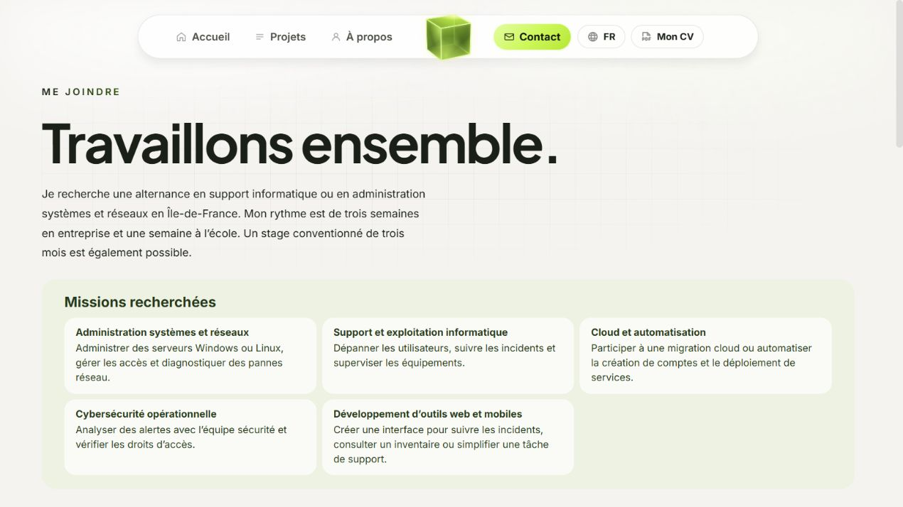
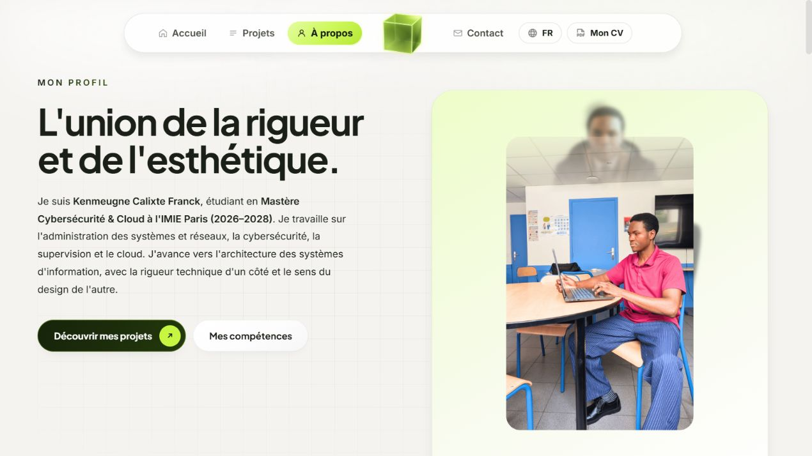

# 02. Lire les références et les écarts

Les captures ci-dessous ont été observées pour cette étude. Les explications distinguent ce qui est visible de l’interprétation de son effet. Elles n’affirment pas connaître les intentions des auteurs des templates.

## Relab : une composition qui déborde intelligemment

Référence : [Relab](https://relab-html.vercel.app/).

Le grand titre noir fournit une structure très lisible. Le cartouche orange, le petit badge blanc incliné et la note latérale n’ont pas la même taille ni la même importance. Le portrait chevauche la transition vers la section suivante. Les petits signes accompagnent le titre sans devenir un second titre.

La lecture probable commence par l’activité, puis l’accent coloré, puis le visage. Les annotations rendent la composition plus particulière, parce qu’elles se rattachent à des éléments forts. Elles ne sont pas réparties uniformément dans tous les espaces libres.

À transférer : construire une hiérarchie, permettre un débordement contrôlé, utiliser une annotation secondaire à une taille vraiment secondaire, équilibrer la position d’un portrait avec la masse du texte. Le fond reste calme malgré plusieurs détails.

À ne pas recopier : les chiffres commerciaux, les témoignages, l’orange, les ornements métalliques ou toutes les sections marketing. Leur utilité dépend de ce que le site doit réellement présenter.

Dans le portfolio, la demande de placer le nom comme la petite annotation de Relab visait son intégration au groupe. Elle ne demandait pas de reproduire « Est. 2023 », ni d’inventer une date fondatrice.

## Minux : contraste typographique et profondeur

Référence : [Minux, Work](https://minux-html.netlify.app/work).

Le texte sans empattement installe la structure. La calligraphie « Project » intervient avec une autre vitesse de lecture, de grandes courbes et une position décalée. Les surfaces sombres comportent plusieurs valeurs : gris, halo et détails de contour. Le fond n’est pas un aplat noir uniforme.

Les arcs et les points créent des repères autour du titre. Le relief reste surtout périphérique. Le cœur de la lecture conserve une zone relativement dégagée.

À transférer : opposer une structure simple et une signature expressive ; réserver un endroit à cette signature ; varier les valeurs pour donner de la profondeur ; relier les détails décoratifs aux axes de la composition.

À ne pas recopier : le thème sombre, le grain partout, les textes anglais commerciaux et une navigation plus complexe que nécessaire. Calixte a explicitement apprécié la composition sans valider les couleurs sombres.

## Premier croquis : propre, mais encore insuffisamment singulier

Cette version a déjà un fond clair, un portrait, un nom lisible, des boutons et des projets. Elle n’est pas inutilisable. Cependant, elle repose surtout sur deux colonnes familières : texte à gauche, image à droite. L’ellipse et les nuages accompagnent le portrait sans construire beaucoup de relations avec la navigation et la suite.

L’intitulé « Réalisations choisies » décrit une sélection plutôt que le contenu ou l’intérêt pour le visiteur. Le passage vers les grandes cartes paraît plus conventionnel que le monde annoncé. Ce diagnostic est une lecture de ce croquis précis, pas une condamnation universelle des dispositions en deux colonnes.

L’erreur aurait été d’ajouter trois effets à cette base et de déclarer l’univers terminé. L’évolution a porté aussi sur la hiérarchie, les proportions, les textes et les interactions.

## Portfolio final : des liens entre les éléments

La navigation flottante forme une unité claire. Le cube occupe une rupture centrale identifiable. Le titre massif est composé en deux lignes ; le prénom calligraphié dispose de son propre espace dessous. La grille légère situe le groupe sans ajouter une illustration concurrente. Le dégradé noir-gris donne du relief aux lettres sans transformer le titre en objet métallique.

Le contraste entre le vert du cube, la signature plus sombre et le bouton principal distribue les accents. Les deux actions restent lisibles comme des actions. La statue vient ensuite prolonger l’univers.

Le résultat ne dépend donc pas seulement d’une belle police. La même calligraphie avait échoué lorsqu’elle était trop petite à côté d’un gros titre, étirée dans un K géant ou placée sur les boutons.

Les quatre images autour de « D’un domaine à l’autre » n’ont pas toutes la même taille ni le même angle. Le centre reste lisible. Les cadres blancs séparent notamment l’image claire de n8n du fond. Les légères différences produisent du rythme, mais les éléments continuent d’appartenir à la même famille.

Le catalogue précise le contexte laboratoire, applications et créations clients. Les catégories aident à parcourir un ensemble plus large que les exemples de l’accueil. Il ne faut pas conclure des quelques exemples affichés que Calixte n’a que quatre réalisations.

La page Contact développe les missions ; le footer peut en proposer une version courte et dépliable. La répétition devient utile quand elle sert un autre moment de lecture et reste synchronisée.

La présentation personnelle peut être plus narrative. Le portrait, les espaces et la hiérarchie la distinguent du catalogue sans quitter la même identité.

## Limite de cette comparaison

La validation globale du portfolio ne transforme pas chacune de ses phrases ni chaque valeur CSS en règle parfaite. Quelques formulations encore présentes peuvent être discutées dans un futur audit. Cette étude ne modifie pas le site. Les captures ne prouvent ni l’accessibilité complète, ni la performance, ni le fonctionnement de tous les états.
